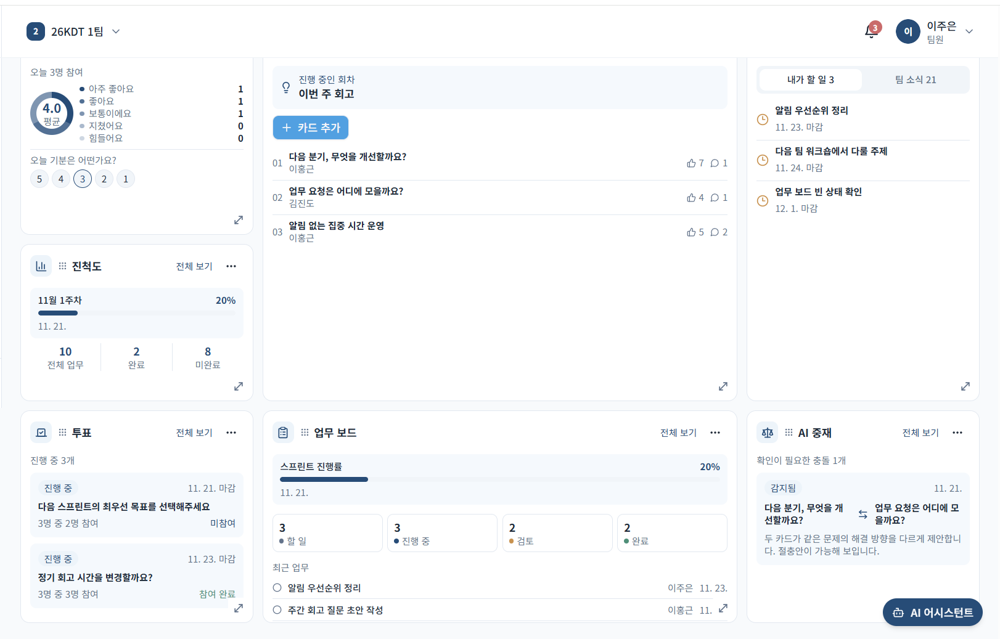
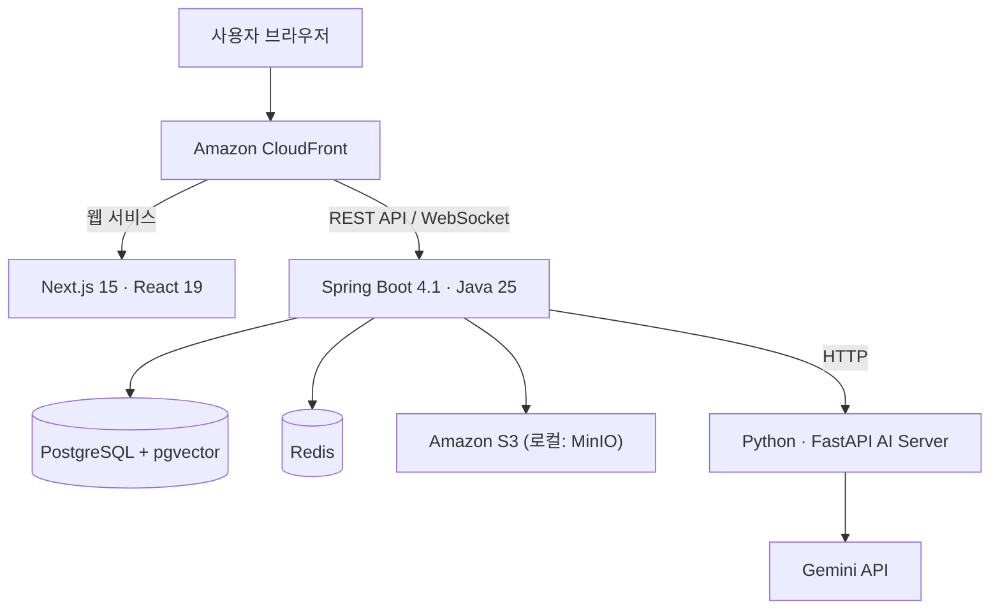

<h1>🌱 MOA — Mind On Agile</h1>

<h3>함께하지 않는 시간에도, 협업은 이어지도록.</h3>

<strong>AI 기반 애자일 협업 플랫폼</strong>  
팀의 아이디어와 업무, 의견과 결정을 하나의 공간에 모읍니다.

 

<a href="https://moayo.site"><strong>🌐 서비스 바로가기</strong></a> · <a href="https://github.com/Five-out-of-five/Moa_Frontend">💻 Frontend</a> · <a href="https://github.com/Five-out-of-five/Moa_Backend">⚙️ Backend</a> · <a href="https://github.com/Five-out-of-five/Moa_Python">🤖 Python AI</a>

---

## 📌 About MOA

**MOA (Mind On Agile)**는 팀의 회의, 아이디어, 업무, 투표를 하나로 모으고 팀의 진행 상황을 대시보드에서 확인할 수 있도록 개발한 **AI 협업 서비스**

- 모든 팀원이 같은 시간에 모이기 어려워도 각자의 시간에 의견을 남기고 변경 사항을 확인하며 함께 의사결정할 수 있도록 **비동기 협업**. 
- AI는 회의 요약, 의견 충돌 감지 및 절충안 제안 등 협업 과정을 보조

### ✨ Key Features

| | 기능 | 설명 |
|:---:|---|---|
| 🏠 | **워크스페이스 & 방 관리** | 소셜 로그인, 방 개설·초대·참여, 방별 프로필과 멤버 관리 |
| 📊 | **협업 대시보드** | 12칸 그리드에 팀이 원하는 위젯을 배치하고 진행 상황 공유 |
| 💡 | **아이디어 & KPT** | 회차별 아이디어 카드, 댓글·리액션, Keep·Problem·Try 회고 |
| ✅ | **업무 & 스프린트** | 칸반·캘린더, 진척도, 업무 배분, 스프린트 관리 |
| 🗳️ | **의사결정 투표** | 찬반·단일·복수 투표를 통한 팀 의견 수렴 |
| 🤖 | **AI 중재 & 회의 지원** | 의견 충돌 감지, 절충안 제안, 회의 요약, 어시스턴트 |
| 📝 | **캐치업 브리핑** | 미접속 기간 동안 발생한 주요 변경 사항 요약 |
| 💬 | **실시간 채팅 & 알림** | 채널·DM 채팅, 읽음·입력 상태, STOMP 기반 알림 |
| 🔗 | **외부 서비스 연동** | Slack 알림 및 Notion 회고 내보내기 |

<a href="https://moayo.site"><strong>🚀 MOA 서비스 체험하기</strong></a>

  

  

---

<h2 align="center">🛠️ Tech Stack</h2>

Technologies used in MOA

<h3 align="center">💻 Frontend</h3>

  
  
  
  
  

<h3 align="center">⚙️ Backend</h3>

  
  
  
  
  

<h3 align="center">🗄️ Database & Cache</h3>

  
  
  
  

<h3 align="center">📡 Real-time Communication</h3>

  
  

<h3 align="center">🤖 AI</h3>

  
  
  

<h3 align="center">☁️ Infra & DevOps</h3>

  
  
  
  
  
  
  
  

<h3 align="center">🧰 Tools & Collaboration</h3>

  
  
  
  
  

---

## 🏗️ System Architecture

- **Frontend:** Next.js App Router 기반 UI 및 BFF 계층
- **Backend:** Spring Boot 기반 인증, 협업 도메인 API, WebSocket(STOMP) 실시간 통신
- **AI:** Spring 백엔드에서 내부 Python AI 서버를 HTTP로 호출
- **Data:** PostgreSQL/pgvector, Redis, 파일 스토리지(S3/로컬 MinIO)
- **Deployment:** AWS 인프라, CloudFront 기반 서비스 접근, GitHub Actions를 이용한 자동화

---

<h2 align="center">👥 Meet Our Team</h2>

오점만점 (Five out of Five) · Frontend 2명 · Backend 3명

<table align="center">
  <tr>
    <td align="center" width="145">
       
      <b>이주은</b> FE-1 
      <a href="https://github.com/jia40">@jia40</a>
    </td>
    <td align="center" width="145">
       
      <b>김진도</b> BE-3 
      <a href="https://github.com/JindoKim">@JindoKim</a>
    </td>
    <td align="center" width="145">
       
      <b>백승재</b> BE-2 
      <a href="https://github.com/baek1885-dev">@baek1885-dev</a>
    </td>
    <td align="center" width="145">
       
      <b>이하연</b> BE-1 
      <a href="https://github.com/lhy1234lhy">@lhy1234lhy</a>
    </td>
    <td align="center" width="145">
       
      <b>이홍근</b> FE-2 
      <a href="https://github.com/zana0422-creator">@zana0422-creator</a>
    </td>
  </tr>
</table>

### 💻 Frontend

| 팀원 | 담당 영역 | 상세 역할 |
|---|---|---|
| **[이주은](https://github.com/jia40)** · FE-1 | 앱 입구 · 방 · 대시보드 · 아이디어 · AI | 랜딩·로그인·회원가입, 계정 설정·방별 프로필, 방 목록·개설·초대·설정, 파일·공지 배너·신고 창, **12칸 그리드·위젯 공통 틀**, 상태값·아이디어 보드·브리핑·중재 위젯, AI 화면 |
| **[이홍근](https://github.com/zana0422-creator)** · FE-2 | 업무 · 투표 · 채팅 · 운영 | 업무 보드·진척도·스프린트, 투표 위젯, 사이드바 채팅, 헤더 알림·알림 설정, Slack·Notion 연동 설정, 관리자 페이지 |

### ⚙️ Backend

| 팀원 | 담당 영역 | 상세 역할 |
|---|---|---|
| **[이하연](https://github.com/lhy1234lhy)** · BE-1 | 인프라 · 사용자 · 방 · 운영 | AWS 인프라·배포(EC2·RDS·Redis), S3 파일, 소셜 로그인·JWT, 계정·탈퇴, 방 개설·초대·참여·멤버·방별 프로필, 관리자·공지·신고, 공통 응답·에러 형식 및 보안 설정 |
| **[백승재](https://github.com/baek1885-dev)** · BE-2 | 대시보드 · 아이디어 · AI | 대시보드 레이아웃·위젯·AI 구성, 상태값·회차, 아이디어 카드(댓글·리액션·첨부), 캐치업 브리핑, AI 중재(충돌 감지·절충안), 어시스턴트·회의 요약·톤앤매너, Slack·Notion 연동 |
| **[김진도](https://github.com/JindoKim)** · BE-3 | 업무 · 투표 · 실시간 · 채팅 | 칸반·업무량 밸런서·진척도, 스프린트, 투표, WebSocket(STOMP) 기반 채널·DM 채팅, 메시지 읽음·입력 중 상태, 알림·알림 설정 |

---

## 🤝 How We Collaborate

<strong>Issue → Branch → Pull Request → Code Review → CI → Merge → Deploy</strong>

| 단계 | 협업 방식 |
|---|---|
| **Issue** | 기능·버그·문서 작업을 이슈 단위로 관리 |
| **Branch** | `feat/`, `fix/`, `docs/` 등 목적에 맞는 브랜치로 작업 |
| **Pull Request** | 변경 사항 및 검증 내용을 PR에 기록하고 리뷰 요청 |
| **Review & CI** | 코드 리뷰, 타입·빌드·테스트 등 자동화 검사 수행 |
| **Merge & Deploy** | 프로젝트별 브랜치 정책에 따라 병합하고 GitHub Actions로 배포 자동화 |

> 세부 브랜치 규칙과 실행 방법은 각 레포지토리 README를 참고해 주세요.

---

## 📂 Repositories

| Repository | Description | Tech |
|---|---|---|
| **[🖥️ Moa_Frontend](https://github.com/Five-out-of-five/Moa_Frontend)** | 웹 인터페이스, 협업 대시보드, 사용자 경험 | Next.js · React · TypeScript |
| **[⚙️ Moa_Backend](https://github.com/Five-out-of-five/Moa_Backend)** | 인증·협업 도메인 API, 실시간 통신, 데이터 관리 | Java · Spring Boot · PostgreSQL |
| **[🤖 Moa_Python](https://github.com/Five-out-of-five/Moa_Python)** | AI 요약·중재·어시스턴트 기능을 위한 내부 서버 | Python · FastAPI · Gemini |

---

<h3>🌱 Five out of Five</h3>

<strong>서로 다른 의견과 역할을 모아, 더 나은 협업을 만듭니다.</strong>

<a href="https://moayo.site">🌐 MOA 서비스</a> · <a href="https://github.com/Five-out-of-five">🏠 Organization</a>

